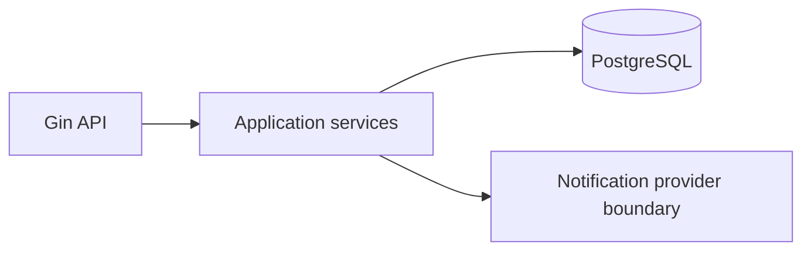

# Cardamom Dryer

A production-oriented Go modular monolith for tracking cardamom receipt, drying, invoicing and payments. It uses Gin, PostgreSQL, GORM, JWT, bcrypt, `NUMERIC` decimal amounts, and transaction-bound business workflows.

## Assumptions

- Rates and taxes are supplied when charges/invoices are created; pricing-rule administration is intentionally a follow-on API.
- A final weight and at least one captured charge are required before invoicing.
- Invoice issue is idempotent by job: a repeated request returns the existing invoice.
- Notifications/PDF delivery are extension points; credentials and provider calls are never hard-coded.

## Run

Copy `.env.example` to `.env`, set a strong `JWT_SECRET`, then run `docker compose up --build`. Development migrations run once at startup and are version-tracked in `schema_migrations`. The full operational schema is in `migrations/000001_initial.up.sql`; use that file with golang-migrate or your deployment migration runner.

`go test ./...` runs the state-machine unit test. The browser-based operations UI is served at `http://localhost:8080/`; Swagger is intentionally not included.

## Architecture



## API

All `/api/v1` business routes require `Authorization: Bearer <access token>`. Start at `POST /api/v1/auth/login`; API metadata is available at `/swagger/openapi.yaml`.

Core workflow: create customer → create job with received weight → transition status → add final measurement and charges → issue invoice → record payments.

### Example

```sh
curl -X POST localhost:8080/api/v1/auth/login -H 'Content-Type: application/json' \
  -d '{"email":"admin@example.com","password":"password"}'
```

Create development users through an approved seed process after migrations; this repository deliberately does not ship a live default password.

## Production notes

Run the authoritative versioned migrations before deploying and set `RUN_MIGRATIONS=false` in multi-instance production deployments. Terminate TLS at a reverse proxy, provide a strong randomly generated JWT secret, apply rate limits at the proxy, and replace the notification/PDF boundary with your selected WhatsApp/SMS and PDF providers. No credentials are committed.
